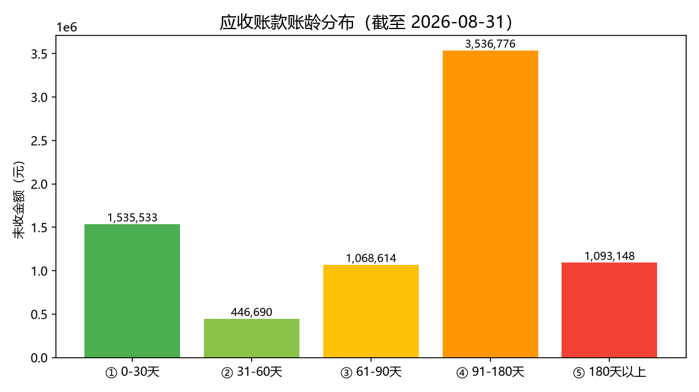

# 会计人的 Python 实战

> 不写 hello world，只写财务每天真在干的活。
> 批量并表、账龄分析、自动对账、凭证查错——每个案例都可以直接拿去用。

[](#)
[](#)
[](#)

---

## 这个仓库是干嘛的

给会计、审计、财务人的 Python 实战教程合集。

不讲语法理论，每期解决一个财务岗真实痛点：

- 月底 12 家分公司报表怎么一键合并？
- 应收账款账龄怎么自动分档，争议单据怎么自动挑出来？
- 发票台账和银行流水怎么自动对账，三类差异一秒列清？
- 几百张凭证的断号、重号、日期倒挂怎么一次扫出来？

每个案例都附带**示例数据**（全部虚构，可直接跑），跟着做一遍就能用在自己公司的数据上。

## 案例目录

| 案例 | 解决什么问题 | 核心技能 | 预计耗时 |
|------|-------------|----------|----------|
| [案例01 多子公司批量并表](案例01_多子公司批量并表/) | 12 张报表合并成一张总表，自动发现哪家漏报 | pandas 读表、合并、分组汇总 | 10 分钟 |
| [案例02 往来账龄分析](案例02_往来账龄分析/) | 应收账款按账龄分档、客户欠款排行、争议单据预警 | 日期计算、分箱分档、matplotlib 画图 | 10 分钟 |
| [案例03 发票银行流水自动对账](案例03_发票银行流水自动对账/) | 找出"开了票没到账 / 金额对不上 / 到账没发票"三类差异 | 表连接（merge）、差异分类 | 10 分钟 |
| [案例04 凭证断号查重检查](案例04_凭证断号查重检查/) | 自动扫出凭证断号、重号、日期倒挂、金额异常 | 集合运算、异常值检测 | 10 分钟 |

## 效果图

账龄分析一键出图：



## 怎么开始用（零基础版）

**第一步：装 Python**

去 Python 官网（python.org）下载安装包，安装时**务必勾选"Add Python to PATH"**（就是那一行英文的小方框，勾上），其他一路下一步。

**第二步：装需要的库**

按 `Win + R` 键，输入 `cmd` 回车，在黑窗口里粘贴下面这行再回车：

```
python -m pip install pandas openpyxl matplotlib
```

**第三步：下载本仓库**

点本页右上角绿色按钮 `Code` → `Download ZIP`，解压到任意位置。

**第四步：生成示例数据**

在解压后的文件夹空白处按住 `Shift` 键点鼠标右键 → 选择"在此处打开 PowerShell 窗口"或"在终端中打开"，输入：

```
python 一键生成示例数据.py
```

回车后会在 `示例数据` 文件夹里生成全部练习数据。

**第五步：跑一个案例试试**

```
python 案例01_多子公司批量并表/批量并表.py
```

看到终端里打印出汇总表，就说明跑通了。结果文件会存在各案例文件夹的 `输出` 子文件夹里。

## 把案例用在自己的数据上

1. 打开 `示例数据` 里对应的 CSV，看清楚列名和格式
2. 把你的 Excel 数据另存为同格式 CSV（Excel 里"另存为 → CSV UTF-8"）
3. 把脚本开头的数据路径改成你的文件路径
4. 重新运行

## 适合谁

- 财会类在校生：ACCA / 初级会计备考间隙，想学点能写进简历的硬技能
- 出纳 / 会计 / 审计：月底被重复劳动折磨的人
- 财务共享 / 数字化方向的从业者

## 协议

MIT，随便用。示例数据全部虚构，如有雷同纯属巧合。
